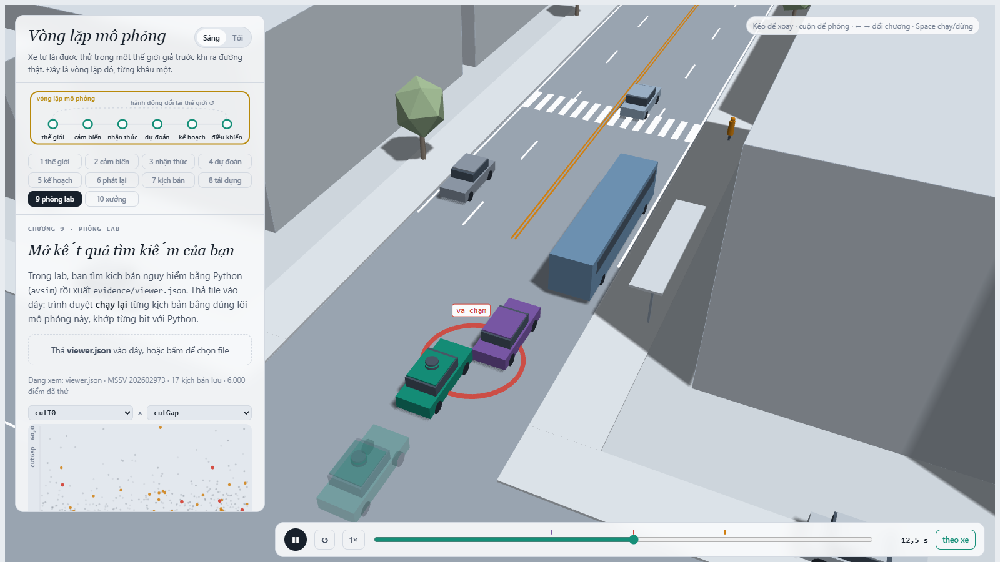
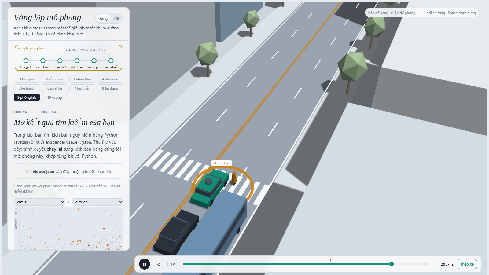
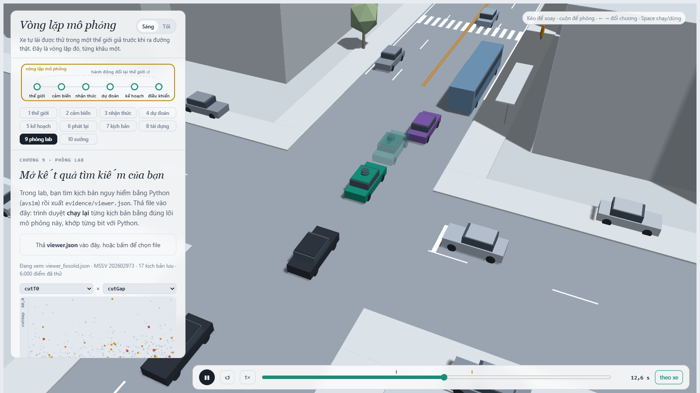
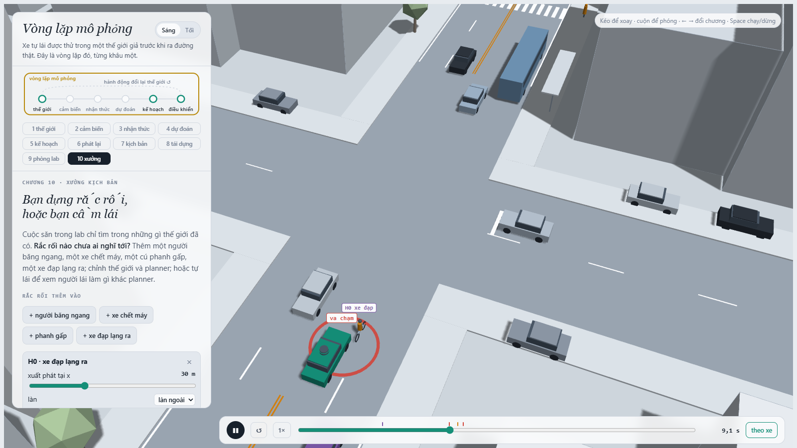
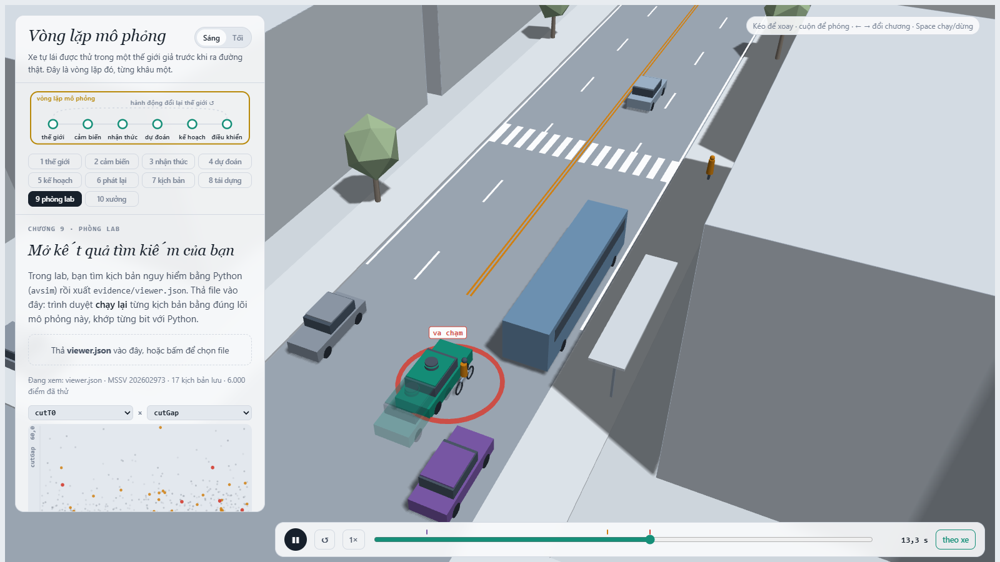
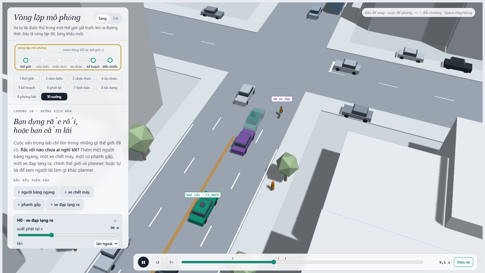

MSSV: 202602973

# Lab 11 · Scenario Forge — báo cáo

Mọi con số dưới đây lấy từ `evidence/` của lần chạy đầy đủ (không `--quick`, `meta.json: _run.quick = false`). Ngân sách: `meta.json: _run.budgets`.

Thị trấn của bạn (`meta.json: _run.town`): **B** ("rainier": `space.VARIANTS`, p(đường ướt) = 0,30, p(ngó qua xe buýt) = 0,85, p(phanh sau khi vào làn) = 0,15, trung vị `cutGap` = 12 m).

## 1. Phát lại log có trung thực không? (bước A)

| `replay.json` | giá trị |
|---|---|
| `n` / `dropped_human_crash_logs` / `n_used` | 400 / **2** / 398 |
| phát lại: `replay.crashes` | **110** (`rear` **100**, `side` **10**, `front` 0) |
| phản ứng: `reactive.crashes` | **0** |
| `crash_in_both` | 0 |

Hai log bị bỏ vì chính người lái gây va chạm: log thật không chứa tai nạn của chính nó.

**Vì sao phần lớn là `rear`:** planner thận trọng hơn người lái trong log. Nó có headway T = 1,6 s so với 1,1 s của người (`core.HUMAN`), và giảm còn `cautionV` = 7,5 m/s khi đến gần vạch bị xe buýt che. Vì vậy nó phanh **sớm hơn** người lái. Khi phát lại, xe bám đuôi TG chạy đúng quỹ đạo đã ghi: quỹ đạo đó phản ứng với chiếc xe *người lái*, chiếc xe phanh muộn hơn. Log không biết planner đã phanh sớm, nên TG lao vào đuôi xe ta. Đây là va chạm **giả**: trong thế giới phản ứng, TG là IDM, thấy xe ta chậm lại và phanh theo, nên số va chạm là 0. Bằng chứng: không kịch bản nào va chạm ở cả hai cách (`crash_in_both = 0`). Mười va chạm `side` cũng cùng nguồn gốc: C2 chuyển làn theo log vào chỗ mà người lái để trống, nhưng planner lúc đó đang ở chỗ khác.

**Một kịch bản trong `replay_only`:** `scenario = 10` (`contact = "rear"`, `min_ttc_reactive = 2.72`). Có `cutT0` = 2,7 s, `cutDs` = −8,6 m, `tgT` = 1,19 s: C2 vào làn sớm ngay trước xe ta. Planner lùi lại để giữ khe 1,6 s và phanh mạnh hơn người lái đã làm. TG trong log theo sát với headway 1,19 s và không phanh tương ứng, nên đâm đuôi. Trong thế giới phản ứng, cùng kịch bản đó chỉ là một tình huống căng: TTC nhỏ nhất 2,72 s, không va chạm.

## 2. Kịch bản bất khả thi (bước B)

Các luật trong `feasible.is_feasible` (μ = `p["mu"]`, g = 9,81):

| Luật | Căn cứ vật lý |
|---|---|
| a_lat = (π/cutDur)²·3,5/2 > μg ⇒ loại | Chuyển làn 3,5 m theo dạng cosin có gia tốc ngang đỉnh bằng công thức đó. Lốp không tạo được lực ngang lớn hơn ma sát μ·m·g: vượt quá thì xe trượt, không thể chuyển làn. Đường ướt (μ = 0,5) cần cutDur ≥ π·√(1,75/4,9) ≈ 1,88 s. |
| cutBrake > μg ⇒ loại | Gia tốc phanh tối đa bằng μg (giới hạn ma sát). |
| pedV > 2,5 m/s ⇒ loại | Người đi bộ đi khoảng 1,2–1,6 m/s; 2,5 m/s đã là chạy. Kịch bản "người đi bộ" mà chạy thì không còn thuộc loại này. |
| cutV ∉ (0, 22] m/s ⇒ loại | Xe đứng yên không "chuyển làn"; 22 m/s ≈ 80 km/h là quá xa tốc độ của con phố đô thị này. |

**Cuộc săn có nhiều kịch bản bất khả thi nhất:** `hunt.json: rear_ended.infeasible = 14`. Các cuộc săn khác: `cut_in` 2, `crosswalk_block` 2, `bus_bypass` 1; Monte Carlo có `mc.json: infeasible = 22` trên 3 000 lần.

Điểm nguy hiểm của `rear_ended` là TTC của TG lao vào xe ta. Điểm này cao nhất khi xe ta bị buộc phanh gắt, tức khi C2 lách vào cực nhanh ngay trước mặt (cutDur ngắn), nhất là trên đường ướt. Đó cũng chính là vùng a_lat > μg. CEM chỉ thấy "điểm cao = tốt", nên bị kéo thẳng về những kịch bản vật lý không cho phép, vì chúng "nguy hiểm" nhất.

**Nếu đếm chúng là va chạm:**
- Elite của CEM sẽ đầy kịch bản bất khả thi, q hội tụ vào vùng đó.
- Tử số của IS chứa những va chạm không thể xảy ra, nên ước lượng bị **chệch lên**.
- Ta sẽ báo một kiểu thất bại (`rear_ended`) mà ngoài đời không có. Việc "sửa" planner theo nó là sửa một lỗi không tồn tại.

## 3. Monte Carlo cho bạn biết gì (bước C1)

`mc.json`:
- `n` = **3 000**, `crashes` = **3**, `p` = **1,00·10⁻³**.
- Khoảng Wilson 95 %: [`lo` = **3,40·10⁻⁴**, `hi` = **2,94·10⁻³**].
- Cả 3 va chạm đều là `bus_bypass` (`modes`).

**Cần bao nhiêu lần chạy để có ±20 %:** nửa độ rộng tương đối là 1,96·√((1−p)/(n·p)) = 0,2, suy ra n ≈ 1,96²/0,2² · (1−p)/p ≈ 96/p. Với p̂ = 10⁻³, n ≈ **96 000** lần chạy, gấp 32 lần ngân sách hiện có.

**Kiểu chưa hề xuất hiện:** `cut_in`, `crosswalk_block`, `rear_ended` và `other` đều có k = 0 trong 3 000 lần chạy. Con số đúng để báo **không phải 0** mà là cận trên Wilson: `mc.json: per_mode.<mode>.hi` = **1,28·10⁻³** cho mỗi kiểu (gần với quy tắc 3/n = 10⁻³). Phát biểu đúng là: "ở mức tin cậy 95 %, mỗi kiểu này < 1,3·10⁻³", không phải "không bao giờ xảy ra". Bước C3 cho thấy `crosswalk_block` thật ra có xảy ra, ở cỡ 10⁻⁶–10⁻⁵.

## 4. Importance sampling, ESS và độ suy biến (bước C3)

`estimate.json` (mỗi seed `n` = 600 mẫu cho mỗi kiểu, rút từ q = 0,8·CEM + 0,2·tự nhiên):

| seed | kiểu | `p` | `hits` | `ess` | `top_share` |
|---|---|---|---|---|---|
| 0 | bus_bypass | 1,19·10⁻³ | 59 | 115,9 | 0,474 |
| 0 | cut_in | 0 (cận `upper_zero_hits` 0,025) | 0 | 127,0 | 0 |
| 0 | crosswalk_block | 1,26·10⁻⁶ | 73 | 118,2 | 0,227 |
| 0 | rear_ended | 0 (cận 0,025) | 0 | 114,4 | 0 |
| 1 | bus_bypass | 1,53·10⁻³ | 48 | 117,1 | 0,128 |
| 1 | cut_in | 0 (cận 0,025) | 0 | 132,1 | 0 |
| 1 | crosswalk_block | 4,56·10⁻⁵ | 86 | 123,4 | **0,981** |
| 1 | rear_ended | 0 (cận 0,025) | 0 | 137,5 | 0 |
| 2 | bus_bypass | 1,13·10⁻³ | 45 | 131,4 | 0,140 |
| 2 | cut_in | 0 (cận 0,025) | 0 | 119,4 | 0 |
| 2 | crosswalk_block | 2,99·10⁻⁶ | 62 | 126,3 | **0,590** |
| 2 | rear_ended | 0 (cận 0,025) | 0 | 114,7 | 0 |

Tổng qua các kiểu, kể cả `other`: seed 0 **1,20·10⁻³** [4,9·10⁻⁵, 3,62·10⁻³]; seed 1 **1,57·10⁻³** [8,0·10⁻⁴, 3,62·10⁻³]; seed 2 **1,14·10⁻³** [5,5·10⁻⁴, 3,00·10⁻³]. Trung vị là 1,20·10⁻³.

**Ba seed có đồng ý không:**
- *`bus_bypass`:* có. Ba seed nằm trong 1,13–1,53·10⁻³ (chênh ×1,35), và khớp Monte Carlo (p̂ = 10⁻³, Wilson [3,4·10⁻⁴, 2,9·10⁻³]). Tổng của cả ba seed cũng nằm trong khoảng Wilson của MC.
- *`crosswalk_block`:* **không**. Ba seed cho 1,26·10⁻⁶, 4,56·10⁻⁵ và 2,99·10⁻⁶, chênh nhau **36 lần**. Đây đúng là dấu hiệu của cái bẫy 3 (README): cuộc săn tìm *một* cách gây chặn lối, không nhất thiết là cách hay xảy ra nhất. Bằng chứng là `hits` rất cao (62–86 trên 600) mà p chỉ cỡ 10⁻⁶: q nằm ở một góc rất hiếm của không gian.
- *`cut_in`, `rear_ended`:* 0 hits ở cả ba seed. Báo cận trên `upper_zero_hits` = 3/(0,2·600) = **0,025**, không báo 0. Cận này rất lỏng (cao hơn cả tổng): nó chỉ dựa vào 20 % mẫu tự nhiên trong hỗn hợp.

**`top_share` lớn (> 0,5):** `crosswalk_block` seed 1 (**0,98**) và seed 2 (0,59); `bus_bypass` seed 0 gần ngưỡng (0,47). Ở seed 1, 98 % ước lượng 4,56·10⁻⁵ đến từ **một** mẫu có trọng số lớn: một kịch bản va chạm tình cờ rơi vào vùng q thưa mà p dày. Khi đó p̂ ≈ w_max/n, tức con số thực chất là trọng số của một mẫu chia cho 600. Thêm hay bớt mẫu đó, ước lượng nhảy hàng chục lần, nên ±1,96·se không đáng tin. Ngược lại, `top_share` thấp (seed 0: 0,23) cũng **không** chứng minh ước lượng đúng: q có thể bỏ sót hẳn vùng va chạm hay xảy ra hơn, khi đó không mẫu nào nặng ký cả.

**Ngân sách:** `estimate.json: budget` = **16 800** lần chạy cho cả bốn cuộc săn và 3 seed × 4 kiểu × 600 mẫu. So với Monte Carlo cho cùng độ chính xác tương đối (n = (1−p)/(p·(se/p)²)):
- `bus_bypass` seed 1 (se/p = 0,26): MC cần khoảng **10 000** lần. Kiểu này không quá hiếm (≈ 10⁻³), nên IS lợi không nhiều.
- `crosswalk_block` seed 0 (p = 1,26·10⁻⁶, se/p = 0,32): MC cần khoảng **7,9 triệu** lần, gần 500 lần ngân sách IS. MC 3 000 lần chỉ nói được "< 1,3·10⁻³".

**Phần `other`:** `estimate.json: other` lấy từ Monte Carlo C1 (`source = "mc.json"`): k = 0, n = 3 000, p = 0, cận trên 1,28·10⁻³. Nó không được săn vì "other" không phải một cơ chế. Nó là phần còn lại của mọi va chạm không thuộc kiểu nào, nên không có điểm nguy hiểm liên tục nào để CEM leo theo. Chỉ mẫu tự nhiên mới ước lượng không chệch phần đó.

## 5. Các kiểu thất bại (bước C2 + 3D)

`hunt.json: <cuộc săn>.found`:

| Cuộc săn | `found` | Kiểu đúng mục tiêu? |
|---|---|---|
| bus_bypass | {bus_bypass: 174} | có |
| cut_in | {bus_bypass: 38} | **không**: co về bus_bypass |
| crosswalk_block | {crosswalk_block: 55} | có |
| rear_ended | {crosswalk_block: 2, bus_bypass: 3} | **không** |

- **bus_bypass:**

  

  Ảnh: kịch bản `B-01`, t = 12,5 s, đường ướt μ = 0,5, khe chấp nhận 4,7 m. C2 (xe tím) đi ở làn ngoài và bị xe buýt đỗ chắn. Nó chấp nhận một khe rất ngắn (4,7 m) và chen vào làn xe ta ở tốc độ thấp (< 6 m/s, x < 112 m). Xe ta (xanh) đến sau, vẫn còn tốc độ. Trong lúc C2 lấn sang, khoảng lệch ngang của nó còn lớn hơn `cutinLat` = 2,15 m, nên planner chưa coi C2 là xe phía trước và phanh quá muộn. Trên đường ướt, quãng phanh không đủ: xe ta tông vào đuôi C2. Bóng mờ phía sau là bản sửa (`cutinLat` 3,3): nó coi C2 là xe trước sớm hơn và dừng kịp.
- **crosswalk_block:**

  

  Ảnh: kịch bản `C-01`, chặn lối ở t = 20,4 s, đường ướt, P1 không ngó qua xe buýt. Xe buýt ở làn bên che tầm nhìn giữa xe ta và người đi bộ P1. P1 không thấy xe ta nên bước ra; xe ta chỉ thấy P1 khi P1 ra khỏi bóng xe buýt. Xe ta phanh và dừng, nhưng trên đường ướt nó dừng với thân xe nằm trên vạch qua đường, chắn ngay trước mặt P1 (vòng cam "chặn lối"), nên P1 phải đứng lại. Ở cảnh này bản sửa cũng thất bại y hệt (bóng mờ chặn lối cùng lúc 20,4 s): `cutinLat` không liên quan đến người đi bộ.

**Kiểu không tìm thấy:** `cut_in` và `rear_ended` không có va chạm nào đúng kiểu, cả trong săn lẫn trong IS (`hits` = 0). Mức tin: chỉ là "không thấy trong ngân sách này". Cận trên hợp lệ là 0,025 (IS) hoặc 1,28·10⁻³ (MC). Cuộc săn `cut_in` bị kéo về `bus_bypass`, vì điểm nguy hiểm của nó (TTC tới C2) cũng tăng khi C2 lách qua xe buýt. Vậy là ta chưa biết `cut_in` thuần có tồn tại hay không.

**Nếu chỉ chạy một cuộc săn chung:** nó sẽ co về kiểu dễ nhất. Như cuộc săn `cut_in` và `rear_ended` đã cho thấy, mọi thứ trôi về `bus_bypass` (174 + 38 + 3 lần). Khi đó `crosswalk_block` gần như không bao giờ được thấy: nó chỉ xuất hiện khi có một cuộc săn riêng, với điểm nguy hiểm riêng là khoảng phanh còn lại trước P1. Đó là lý do mỗi kiểu cần một cuộc săn riêng (bẫy 1).

## 6. Sửa planner (bước E + 3D)

`fix.json`:

| | policy | `fail` | `fail_hi_seen` | `fail_hi` | progress [m] | harsh [frame] | `unseen` |
|---|---|---|---|---|---|---|---|
| TRAIN · gốc (`baseline_train`) | `POLICY` | 5,72·10⁻⁴ | 1,05·10⁻³ | 1,05·10⁻³ | 212,5 | 8,01 | — |
| TRAIN · chọn (`chosen`) | `{"cutinLat": 3.3}` | 7,93·10⁻⁷ | 1,49·10⁻⁶ | 1,49·10⁻⁶ | 211,9 | 7,67 | bus_bypass |
| **TEST · chọn** (`chosen_test`) | `{"cutinLat": 3.3}` | **2,01·10⁻⁷** | **4,52·10⁻⁷** | **3,88·10⁻²** | 213,1 | 7,80 | bus_bypass |
| **TEST · gốc** (`baseline_test`) | `POLICY` | **1,93·10⁻³** | 5,09·10⁻³ | **6,37·10⁻³** | 213,3 | 8,43 | — |

- **Cách chọn:** `choose_policy` chọn `{"cutinLat": 3.3}` **trên TRAIN**, vì nó có `fail_hi` nhỏ nhất trong số các ứng viên giữ ≥ 95 % quãng đường (211,9 ≥ 0,95 × 212,5 = 201,8). Nó hoà `fail_hi` = 1,49·10⁻⁶ với `{"cutinLat": 3.0}`, vì cả hai đều xoá hết `bus_bypass` trên TRAIN và còn 34 hits `crosswalk_block` y hệt nhau. Khi hoà, luật chọn bên có quãng đường dài hơn: 211,87 m so với 211,83 m. Hai ứng viên tốt nhất chỉ khác nhau ở quãng đường, nên TRAIN thực ra không phân biệt được chúng.
- **Kết quả TEST:** TEST dùng seed mới và một cuộc săn mới nhắm vào chính policy đã chọn. Cuộc săn `bus_bypass` mới trên TEST không tìm ra va chạm nào (8 vòng, `crashes 0`). Trong khi đó policy gốc trên TEST vẫn có 14 hits `bus_bypass`.
- **Quãng đường và phanh gấp:** quãng đường gần như không đổi (213,1 so với 213,3 m). Số frame phanh gấp giảm từ 8,43 xuống 7,80.

**Vì sao `fail_hi` của bản sửa (3,88·10⁻²) lớn hơn cả `fail` của policy gốc (1,93·10⁻³) dù bản sửa tốt hơn thật:**
- `bus_bypass` là `unseen` với bản sửa, nên cận của nó là `upper_zero_hits` = 3/(0,2·400) = **0,0375**.
- Cộng thêm `other_crashes.hi` = 1,28·10⁻³ (MC tự nhiên 3 000 lần) và `crosswalk_block`, ta được fail_hi = 3,88·10⁻².
- Với n = 400 mẫu/kiểu, không có cách nào chứng nhận một kiểu đã biến mất dưới khoảng 15/n ≈ 10⁻². Dữ liệu cho thấy (`fail_hi_seen` = 4,5·10⁻⁷) rằng bản sửa xoá được mọi va chạm đã gặp. Nhưng cận **hợp lệ** cho cả policy vẫn chỉ là 3,9·10⁻², vì lý do thống kê chứ không phải do policy xấu đi. Muốn chứng nhận `bus_bypass` < 10⁻³ cần cỡ 15 000 lần chạy trên đúng vùng đó.

**Ảnh có bóng mờ:**

Ảnh: kịch bản `B-02`, t = 12,6 s, đường ướt μ = 0,5. Ảnh được chụp từ một bản sao của `evidence/viewer.json` đã gỡ phần gắn policy của từng kịch bản (`runs[].policy`); mọi tham số kịch bản giữ nguyên. Khi đó trình xem chạy **bản sửa `{"cutinLat": 3.3}` bằng xe đặc** và **policy gốc bằng bóng mờ**. Bảng đọc ra: `chính sách của bạn: không va chạm`, `chính sách gốc: va chạm 12,6 s`. Cả bốn kịch bản `B-01`…`B-04` đều như vậy.

Bóng mờ (policy gốc) giữ tốc độ lâu hơn và chạm đuôi C2 (xe tím) đúng lúc C2 chen vào làn xe ta để lách xe buýt. Xe đặc (bản sửa) coi C2 là xe phía trước ngay khi C2 lệch vào trong vòng 3,3 m, thay vì 2,15 m, nên phanh sớm hơn và dừng phía sau, để C2 vào trước.

**Núm "nghe thì an toàn hơn" nhưng phản tác dụng** (TRAIN, `fix.json: table`):

| ứng viên | `fail` TRAIN | so với gốc 5,72·10⁻⁴ | progress |
|---|---|---|---|
| `{"T": 2.0}` (giữ khoảng cách xa hơn) | **3,54·10⁻³** | **×6,2 tệ hơn** (34 bus_bypass, 55 crosswalk_block hits) | 202,7 |
| `{"cautionV": 6.0}` (đi chậm hơn gần vạch) | 1,05·10⁻³ | ×1,8 tệ hơn | 189,2 |
| `{"cautionV": 6.5}` | 8,70·10⁻⁴ | ×1,5 tệ hơn | 198,4 |

Giải thích bằng phản ứng của thế giới:
- **Headway dài hơn tạo khe lớn hơn trước mũi xe ta.** C2 chấp nhận khe cỡ `cutGap` (trung vị 12 m), nên khe dài hơn *mời* C2 chen vào và lách qua xe buýt đúng trước mặt xe ta. Thêm vào đó, xe ta đến vùng xe buýt muộn hơn. Lúc đó P1 thường đã bắt đầu qua đường, nên tình huống chặn lối tăng (55 hits).
- **`cautionV` thấp hơn làm xe ta đến xe buýt chậm hơn**, đúng lúc C2 đã chờ sau xe buýt và đang tìm khe. Xe ta chậm thì khe cho C2 mở ra, C2 chen vào ở tốc độ thấp ngay mũi xe.
- Chỉ `cautionV` = 5,0 mới giảm thất bại (9,5·10⁻⁵), nhưng mất 20 % quãng đường (170,8 m), nên bị loại.

Thế giới không đứng yên: một thay đổi "an toàn hơn" của xe ta thay đổi quyết định chấp nhận khe của người khác.

## 7. Từ mô phỏng ra đường thật

| Giả định (`space.py`) | Dữ liệu thật để thay | Nếu sai thì con số sai theo hướng nào |
|---|---|---|
| **Khe chấp nhận của xe chuyển làn** `cutGap` ~ lognormal(trung vị 12 m, σ = 0,5). Đây là động lực chính của `bus_bypass`, kiểu chiếm gần như toàn bộ tổng. | Quỹ đạo chuyển làn đo bằng drone hoặc camera cố định: highD / exiD (Đức), NGSIM (Mỹ). Với giao thông Việt Nam: video drone tại các trạm buýt ở TP.HCM/Hà Nội, trích khe chấp nhận khi xe vượt xe buýt đỗ. | Tài xế Việt Nam thường chấp nhận khe nhỏ hơn 12 m. Nếu vậy C2 chen gắt hơn, và P(bus_bypass) của tôi đang **thấp hơn** thực tế. |
| **Tỉ lệ người đi bộ ngó qua xe buýt** `pedLook` = 0,85 | Quan sát video tại vạch qua đường cạnh trạm buýt (kiểu dữ liệu inD, hoặc nghiên cứu hành vi người đi bộ tại trạm); đếm tỉ lệ người dừng nhìn trước khi bước ra khỏi đầu xe buýt. | `crosswalk_block` chỉ xảy ra khi không ngó qua. Nếu thực tế ít người ngó hơn (ví dụ 0,6), ước lượng `crosswalk_block` **thấp hơn thật** gần tỉ lệ (1−0,6)/(1−0,85) ≈ ×2,7. |
| **Đường ướt**: p = 0,30 (thị trấn B) và μ = 0,5 cố định (khô 0,8) | Số liệu khí tượng: số giờ mưa theo giờ đi lại (TP.HCM mùa mưa có > 50 % ngày có mưa từ tháng 5 đến 11). Hệ số ma sát đo bằng xe đo ma sát / dữ liệu ABS của đội xe. | μ ướt thật dao động 0,4–0,7. Nếu thấp hơn 0,5 hoặc tỉ lệ mưa cao hơn, quãng phanh dài hơn: thất bại **bị đánh giá thấp**. Đồng thời luật bất khả thi a_lat ≤ μg loại *nhiều* kịch bản hơn; nếu μ thật cao hơn, ta đang loại oan một số kịch bản cut-in. |

## 8. Giới hạn

1. **Một con phố, một cấu hình cố định:** một xe buýt đỗ trước đúng một vạch qua đường, các xe khác xuất phát ở vị trí gần như cố định. Xác suất của tôi là P(va chạm | đi qua *đoạn phố này*), không phải P(va chạm mỗi km). Không có ngã tư có đèn, không có dòng xe máy dày đặc kiểu Việt Nam.
2. **Người lái khác là IDM + gap acceptance "lịch sự":** không xao nhãng, không vượt ẩu, không vi phạm, phản ứng không trễ. Mọi kiểu thất bại do người khác cư xử *bất thường* (ngoài phân phối giả định) đều không có trong con số.
3. **Cảm biến hoàn hảo** trừ phần bị xe buýt che: không nhiễu, không trễ, không nhận diện sai, các xe con không che tầm nhìn. Planner chỉ phanh, không đánh lái. Thêm nữa, mỗi kịch bản chỉ dài 24 s nên không thấy hậu quả dài hạn.

Nếu có thêm một tuần:
- thêm độ trễ và nhiễu cảm biến (ví dụ 0,2–0,5 s), rồi đo lại `crosswalk_block`;
- chạy một cuộc săn `cut_in` riêng, có ràng buộc loại vùng bus_bypass (x ≥ 112), để biết `cut_in` thuần có tồn tại không;
- tăng ngân sách TEST lên khoảng 15 000 cho `bus_bypass` để chứng nhận bản sửa dưới 10⁻³;
- lấy video trạm buýt thật để ước lượng `cutGap` và `pedLook`.

## 9. Rắc rối của bạn (bước G + chương 10)

- **Brainstorm (các rắc rối đã thử trước khi chọn).** Mỗi loại tôi quét 200 phiên bản trong thế giới mặc định của chương 10, policy gốc. Các con số trong bảng là lần quét thử nhanh ngoài `evidence/`, không phải `mine.json`:

| Rắc rối thử | Khoảng quét | Va chạm của xe ta | Nhận xét |
|---|---|---|---|
| Người băng ngang chỗ không có vạch (bên S và bên N) | x 140–300 m, v 1,0–2,2 m/s, trig 10–35 m | 0/200 mỗi bên | Người đi bộ phải đi khoảng 7 m mới tới làn xe ta, nên planner thấy và dừng kịp |
| Người băng ngang ngay trước đầu xe buýt (bị che) | x 112,5–118 m, trig 15–80 m | 0/200 | `cautionV` gần vạch đã đủ chậm |
| Xe chết máy trong làn xe ta | x 60–300 m | 0/200 | Vật tĩnh, IDM xử lý tốt |
| L1 hoặc C2 phanh gấp | decel 3–7,5 m/s², t0 3–20 s | 0/200 | Headway T = 1,6 s đủ dài |
| Xe đạp lạng ra (đúng khoảng ví dụ trong README) | h0_x −150–250, h0_swerve 0,6–1,8, h0_trig 10–40 | 0/200 | Lạng 1,8 m không đủ để sang làn xe ta |
| **Xe hai bánh vượt xe buýt đỗ, lách sang làn xe ta** | lần thử đầu: h0_x 40–95, v 3–7, swerve 3–4,5, swDur 2,8–4, trig 5–35 | **63/300 (21 %)** | Chọn rắc rối này; `space` cuối cùng nới h0_x thành 20–95 |

  Tôi chọn rắc rối cuối vì nó nhắm đúng điểm yếu đã thấy ở bước C và E: planner chỉ phản ứng với người lấn làn khi họ đã vào trong `cutinLat`. Nó cũng là tình huống rất phổ biến ở Việt Nam, và khác ví dụ README cả về cơ chế (vượt vật cản) lẫn khoảng `space`.
- **Rắc rối:** một xe hai bánh (`type: "bike"`, làn E2, đi sát lề `d` = 1,0) phía trước có xe buýt đỗ đón khách. Để vượt xe buýt, nó **lách mạnh ra làn trong**, tức làn của xe ta (`swerve` 3–4,5 m), mà không nhường. Ngoài đời đây là tình huống rất phổ biến ở Việt Nam: xe máy/xe đạp ở trạm buýt chuyển sang làn trái để vượt xe buýt, nhiều khi không ngoái nhìn phía sau. Trong cảnh dựng ở chương 10 (`hazard.json: hazards[0]`: x = 30, v = 4 m/s, lách 3,5 m trong 3 s, khi xe ta còn cách 20 m), xe hai bánh lách ra sớm, khoảng 40 m trước đuôi xe buýt, gần ngã ba, lúc vẫn đang chạy 4 m/s.
- **Căn cứ (vì sao planner xử lý kém):** trước khi lách, xe hai bánh nằm ở làn bên cạnh, cách tâm làn xe ta khoảng 4,5 m, vượt xa `cutinLat` = 2,15 m. Planner coi nó là "không liên quan" và giữ nguyên tốc độ khoảng 11,5 m/s. Nó chỉ thành "xe phía trước" khi đã lấn vào, và khi đó quá muộn với phanh êm b = 2 m/s². Planner không có khái niệm "người kia sắp phải tránh vật cản nên sẽ nhập làn".
- **Giả định (`hazard.json: why`):**
  - `space`: `h0_x` 20–95 m (5–80 m sau đuôi xe buýt ở x = 100); `h0_v` 3–7 m/s (11–25 km/h); `h0_swerve` 3,0–4,5 m (từ sát lề phải lách ≥ 2,9 m mới qua thân xe buýt rộng 2,55 m); `h0_swDur` 2,8–4,0 s (gia tốc ngang ≤ π²·4,5/(2·2,8²) = 2,8 m/s² < 3 m/s²); `h0_trig` 5–35 m.
  - `exposure` = **0,1/chuyến**: chuyến khoảng 10 km qua khoảng 10 trạm buýt; xe buýt cách nhau 10–15 phút và đỗ 20–40 s, nên khoảng 5 % trạm có xe buýt đang đỗ, tức khoảng 0,5 lần/chuyến; giả định 20 % số lần đó có xe hai bánh đang vượt. Kết quả 0,5 × 0,2 = 0,1. Đây là ước lượng của tôi, chưa đo từ dữ liệu thật; cần video trạm buýt để thay.
- **Kết quả** (`mine.json`). Cảnh gốc: `exact.planner` = `[ego, H0, 9.1 s]` rồi `[ego, C2, 9.95 s]`; `exact.you` = `[C2, H0, 10.3 s]`, tức xe ta không va chạm. Có 1 500 lần rút, `infeasible` = 5, `accepted` = **0,997**, `n` = 1 495, `conditional_on` = "your town's traffic":

| `mine.json` | `baseline` (policy gốc) | `chosen` (`cutinLat` 3,3) |
|---|---|---|
| `crashes` | 249 | 191 |
| `avoidable` | **247** | **186** |
| `unavoidable` | 1 | 5 |
| `unattributed` | 1 | 0 |
| `low_speed` (< 1 m/s) | 21 | **97** |
| `avoidable_foreknown` | 248 | 191 |
| P(lỗi planner \| rắc rối) = `p` [Wilson] | **0,165** [0,147; 0,185] | **0,124** [0,109; 0,142] |
| tần suất mỗi chuyến `per_trip` (cận trên) | **1,65·10⁻²** (1,85·10⁻²) | **1,24·10⁻²** (1,42·10⁻²) |

  - **So với lách xe buýt:** P(`bus_bypass`) của thị trấn khoảng 1,2·10⁻³ mỗi lần qua đoạn phố (`estimate.json`, trung vị total = 1,20·10⁻³). Nếu mỗi chuyến qua một đoạn như vậy, rắc rối xe hai bánh (1,65·10⁻² mỗi chuyến) **nguy hiểm hơn khoảng 14 lần**, dù chỉ xảy ra 0,1 lần/chuyến.
  - **Phân loại va chạm:** gần như mọi va chạm là `avoidable`: phanh hết cỡ ngay khi xe hai bánh bắt đầu lách là tránh được. Vậy đây là lỗi của planner, không phải một rắc rối "100 % va chạm, ai cũng dính". Có 1 va chạm `unattributed`: va chạm thường của thị trấn, xảy ra trước khi rắc rối bắt đầu, không nói gì về rắc rối. `avoidable_foreknown` − `avoidable` = 1, tức xe hai bánh gần như luôn nhìn thấy được, nên cái giá của bị che gần như bằng 0. Đây là lỗi *phản ứng/dự đoán*, không phải lỗi *nhìn*.
  - **Vì sao "tránh được" là chuẩn lạc quan, theo hai hướng:**
    - *Đếm nhiều hơn số mà planner thật tránh được.* Người phanh thử "biết" ngay ở khung hình đầu tiên rằng xe hai bánh sẽ lách, và phanh ở giới hạn lốp μg, không trễ phản ứng. Không planner thật nào đoán được ý định từ khung hình đầu tiên. Vì vậy 247 là **cận trên** của số lỗi thật sự đổ được cho planner.
    - *Đếm ít hơn ở chiều khác.* Chỉ thử **phanh**, không thử đánh lái hay tăng tốc vượt lên. Một số va chạm `unavoidable` (1 với gốc, 5 với bản sửa) có thể tránh được bằng cách lách nhẹ sang trái hoặc đi tiếp cho xe hai bánh ra sau.
  - **Bản sửa ở bước E không cứu:** `cutinLat` 3,3 giảm `avoidable` từ 247 xuống 186 (−25 %), vì nó coi xe hai bánh là "xe trước" sớm hơn khi nó lấn vào trong vòng 3,3 m. Nhưng 97 trên 191 va chạm giờ xảy ra khi xe ta **gần như đứng yên** (`low_speed`, so với 21 của policy gốc). Bản sửa làm xe ta dừng lại đúng trên đường lách của xe hai bánh, và xe hai bánh (vốn không phanh khi đang lách) đâm vào sườn xe ta. Bản sửa dời va chạm sang chỗ khác chứ không xoá nó.
  - **Lưu ý về mô phỏng:** trong một phần các phiên bản quét (`h0_trig` nhỏ, xe hai bánh đến đuôi xe buýt trước), xe hai bánh đã dừng hẳn sau xe buýt theo IDM rồi mới "lách", tức trượt ngang khi đứng yên. Ngoài đời không như vậy. Vì thế tôi dựng cảnh cụ thể ở dạng xe hai bánh còn đang chạy 4 m/s lúc lách. Con số quét vẫn chứa cả những phiên bản kém thực tế đó.
- **Hình:**
  - Planner (chương 10, t = 9,1 s): xe ta (xanh) đâm vào xe hai bánh H0 vừa lách sang làn xe ta.

    
  - Một phiên bản quét trong chương 9, `GB-01` (policy gốc, t = 13,3 s):

    
- **Bạn tự lái thì sao:** có, và **tránh được** (`mine.json: exact.you` không có va chạm nào của xe ta).

  

  Đường lái (`hazard.json: egoAcc`): giữ ga đến 3 s; **nhả ga, giảm −1 m/s² từ 3 đến 6 s** khi thấy xe hai bánh đang tiến về phía xe buýt đỗ (đoán trước nó sẽ phải lách); **phanh −3 m/s² từ 6,5 đến 8,5 s** ngay khi nó bắt đầu lấn ra; rồi tăng ga nhẹ +0,8 m/s² từ 9,5 đến 11 s để bám theo sau nó ở khoảng 4 m/s. Ở 9,1 s xe ta chỉ còn 11 km/h, cách xa phía sau (ảnh); planner lúc đó vẫn chạy khoảng 22 km/h và đâm. Khác biệt chính: tôi **giảm tốc trước khi xe hai bánh lách** vì đoán ý định từ bối cảnh (xe buýt đỗ phía trước nó), còn planner chỉ phản ứng khi nó đã lấn vào. Cái giá: quãng đường ngắn hơn (147 m trong 24 s, tính bằng `core.rollout(ego="script")`; quãng đường trung bình của planner là 212,5 m, `fix.json: baseline_train.progress`). Một cảnh báo: tôi đã xem cảnh này nhiều lần trước khi lái, planner thì không. Phía trước, C2 vẫn đâm vào xe hai bánh ở 10,3 s, nhưng đó không phải lỗi của xe ta.
- **Cách sửa:** chỉnh núm chỉ giúp một phần: `cutinLat` 3,3 chỉ giảm 25 %, và một `v0`/`cautionV` thấp hơn làm mất quãng đường mà không sửa nguyên nhân. Planner cần thêm **logic dự đoán ý định**, đúng như cách tôi lái:
  1. Nhận ra mẫu "người tham gia giao thông ở làn bên cạnh đang tiến đến một vật cản tĩnh" (xe buýt đỗ, xe chết máy) và coi họ là **sắp nhập làn**. Thêm một "xe trước ảo" tại vị trí nhập dự kiến, hoặc giảm tốc về khoảng 5 m/s khi đi ngang vùng đó.
  2. Dự đoán vận tốc ngang: nếu tốc độ lệch ngang hướng vào làn mình > 0,3 m/s thì coi là cut-in ngay, thay vì chờ khoảng lệch < `cutinLat`.
  3. Khi phải dừng, **dừng lùi lại** trước điểm nhập, không dừng ngay trên đường lách của xe hai bánh. Đây là chỗ bản sửa ở bước E thất bại (97 va chạm `low_speed`).
